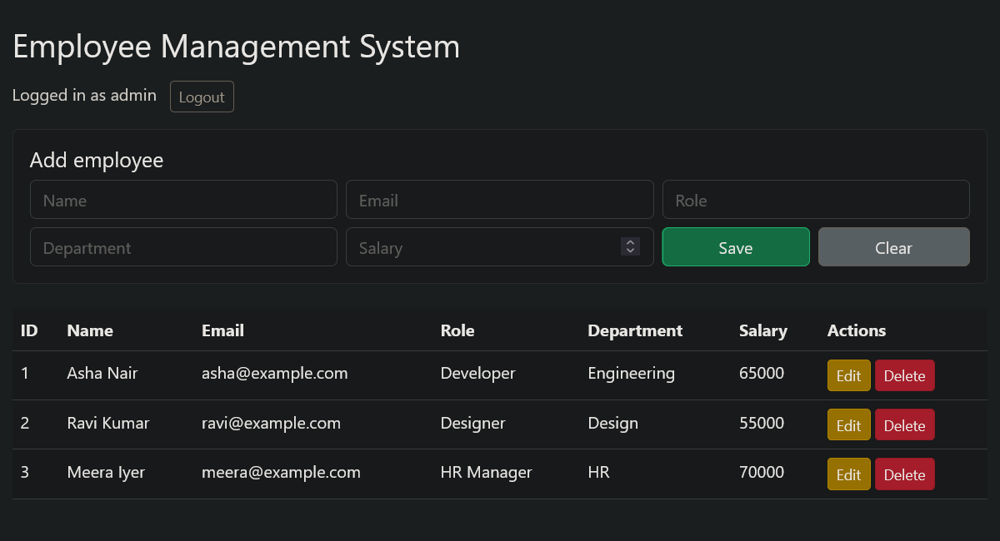
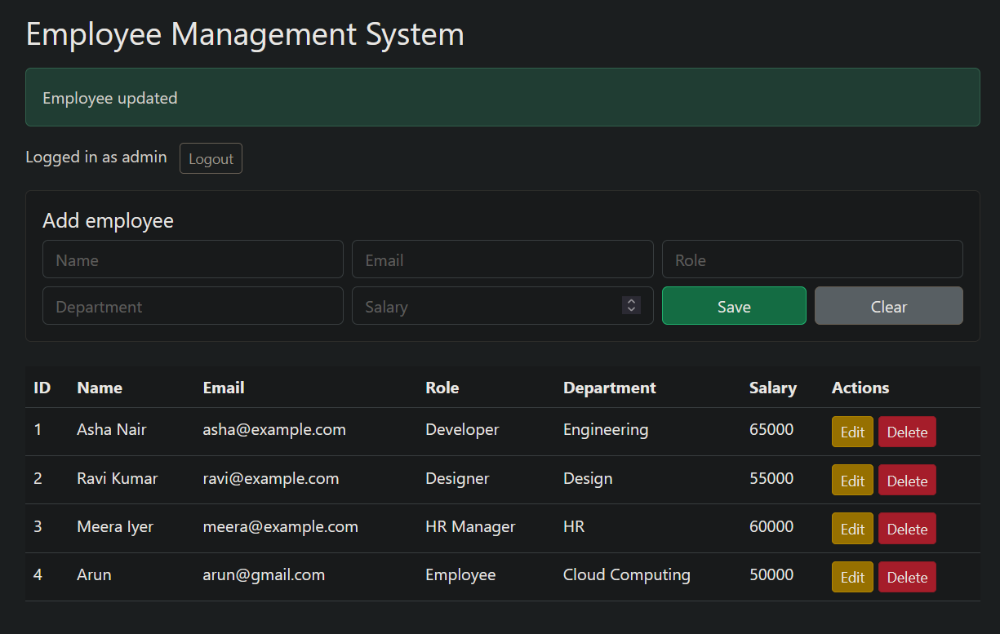
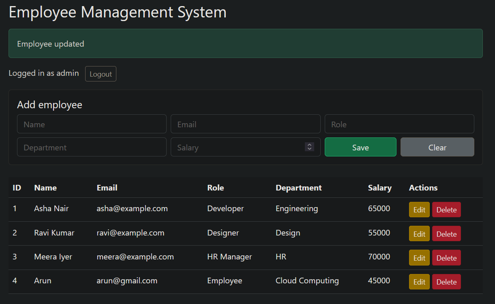
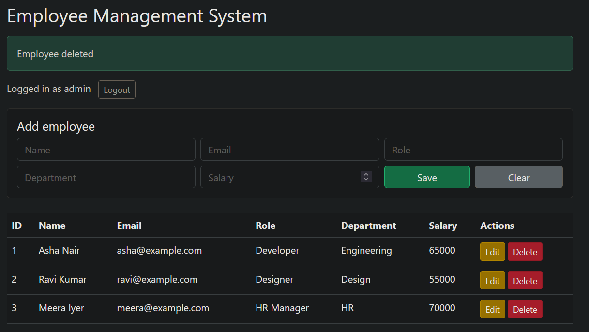
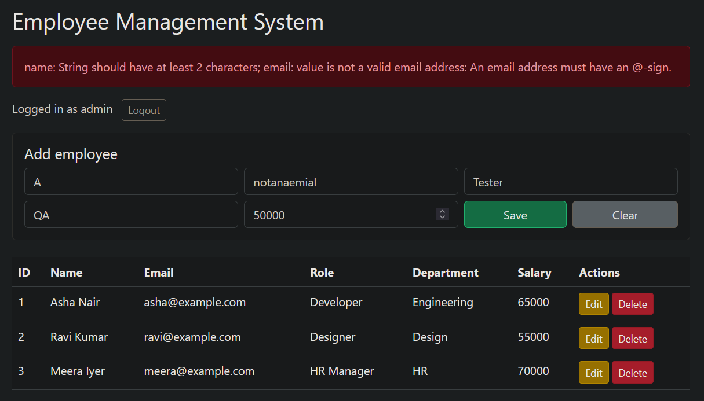
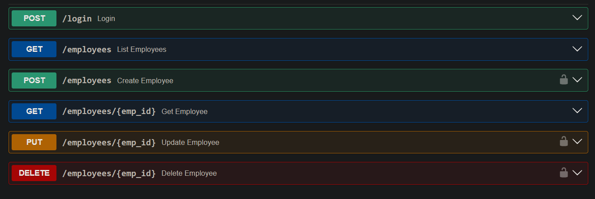

# Employee Management System

FastAPI + SQLite + Bootstrap. Admin-only create, update and delete, with JWT authentication.

## Setup
```bash
python -m venv venv
venv\Scripts\activate
pip install -r requirements.txt
uvicorn main:app --reload
```
Open http://127.0.0.1:8000 (the app) or http://127.0.0.1:8000/docs (the API).

## Demo admin login
`admin@example.com` / `admin12345`. Seed data (1 admin, 3 employees) is created automatically on first run.

## API routes
| Method | Route | Auth | Description |
|---|---|---|---|
| POST | /login | No | Returns a JWT token |
| GET | /employees | No | List employees |
| GET | /employees/{id} | No | Get one employee |
| POST | /employees | Admin | Create an employee |
| PUT | /employees/{id} | Admin | Update an employee |
| DELETE | /employees/{id} | Admin | Delete an employee |

## Sample payloads
Login: `{"email":"admin@example.com","password":"admin12345"}`

Create or update:
```json
{"name":"John Doe","email":"john@example.com","role":"Tester","department":"QA","salary":50000}
```

## Validation and status codes
Name, role and department need at least 2 characters, the email must be valid, and salary must be greater than 0. Status codes: 201, 204, 401, 403, 404, 409, 422.

## Screenshots





